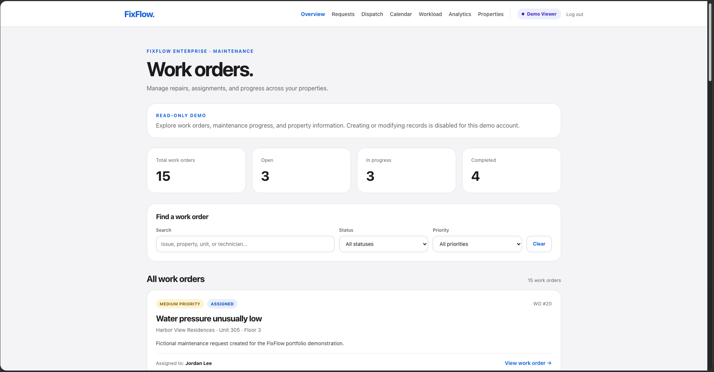
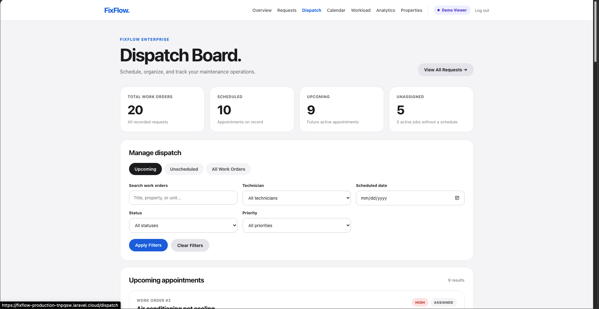
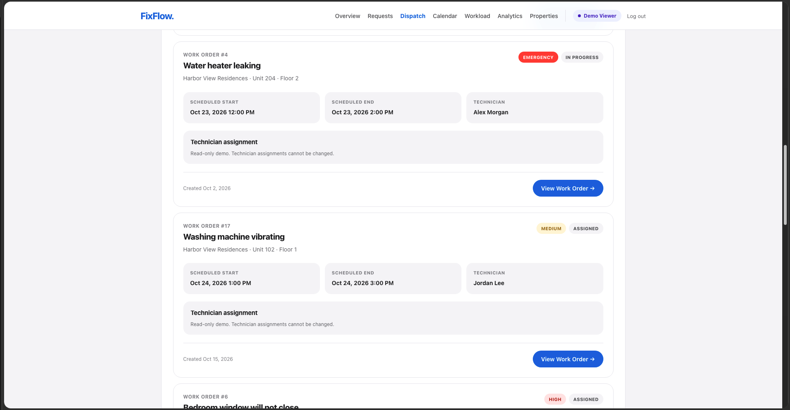
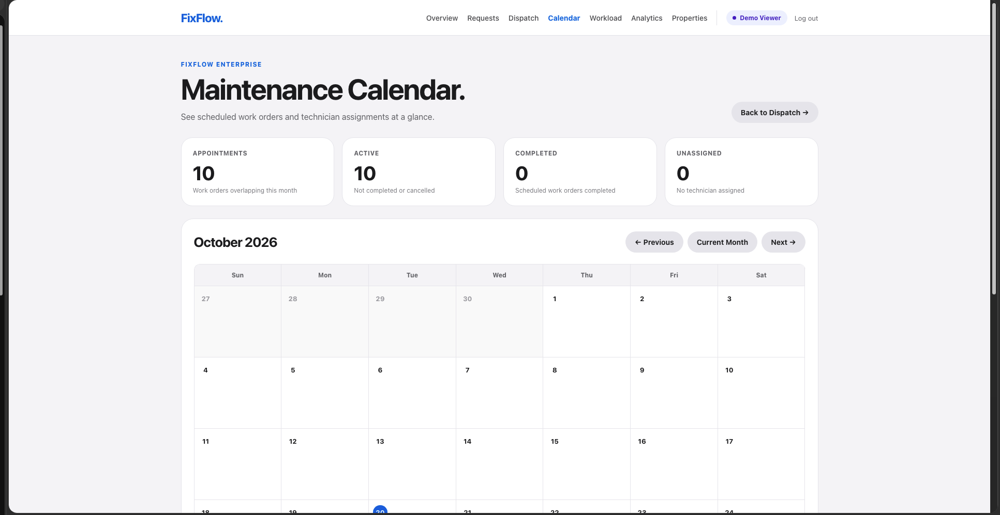
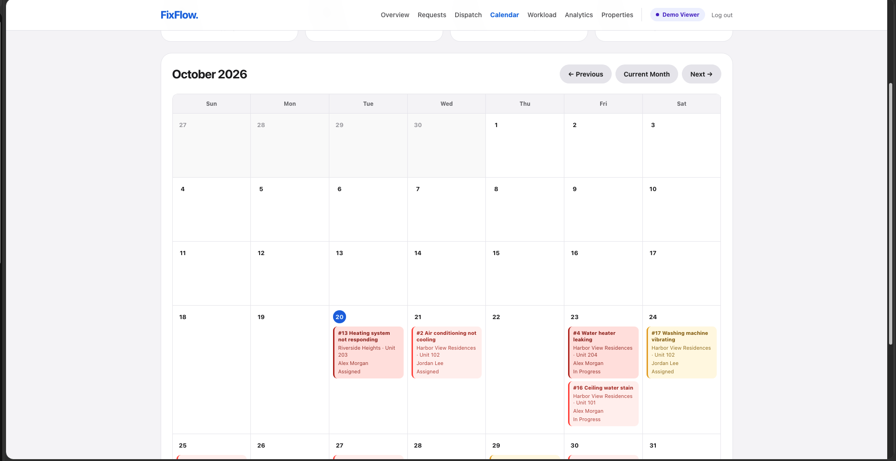
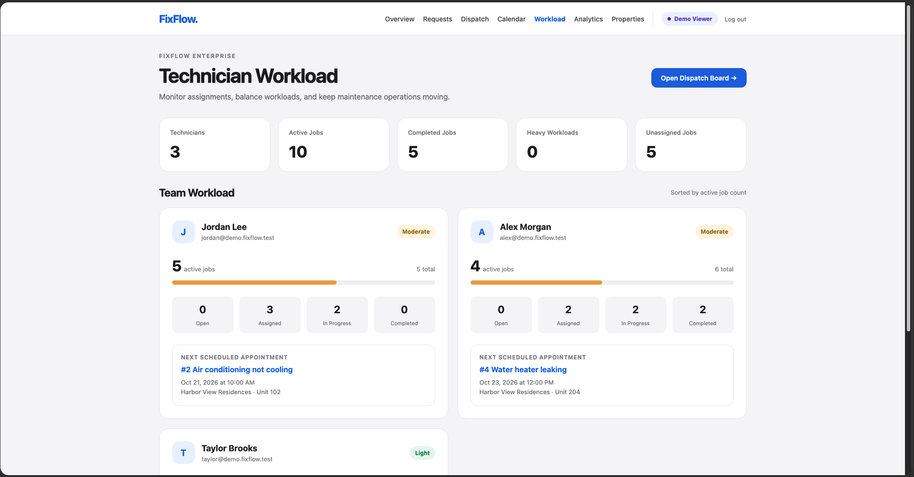
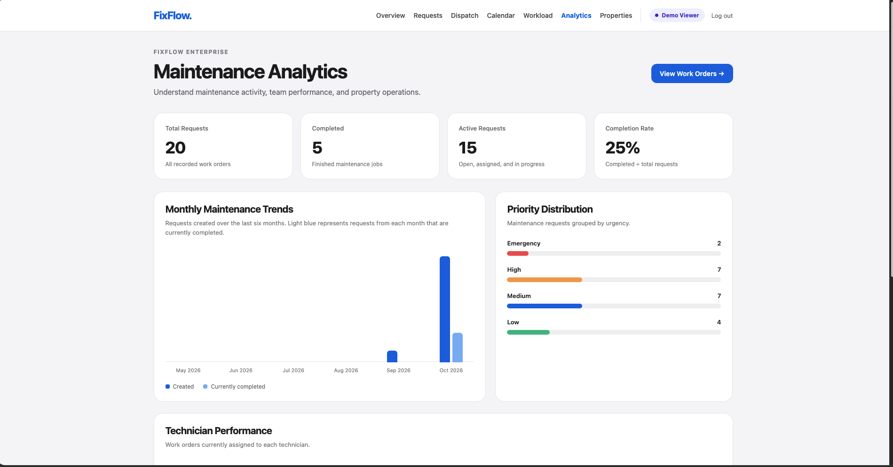
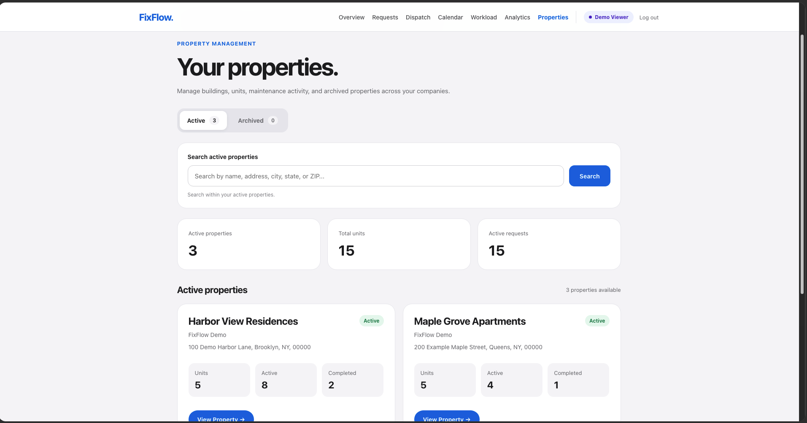

# FixFlow Enterprise

### Multi-Tenant Property Maintenance Management Platform

**A full-stack SaaS application built with Laravel, PHP, and MySQL to manage property maintenance operations across multiple companies.**

[**Try Live Demo**](https://fixflow-production-tnpqsw.laravel.cloud/login) · [**GitHub Repository**](https://github.com/Nousey56/fixflow)

**Status:** Live in Production | Active Development

---

## Overview

FixFlow Enterprise is a property maintenance management platform designed to help property managers, administrators, and technicians coordinate repairs across multiple properties and units.

The application centralizes maintenance requests, technician assignments, scheduling, operational reporting, and property management into one system.

Built as a software engineering portfolio project with commercial SaaS ambitions, FixFlow demonstrates practical experience in backend development, relational database design, multi-tenant architecture, role-based access control, automated testing, and production deployment.

### Project Highlights

- **Multi-tenant architecture** with company-scoped data access
- **Role-based authorization** for administrators, managers, technicians, and demo viewers
- **Maintenance work-order lifecycle** from creation through completion
- **Technician dispatch and scheduling** with calendar visibility
- **Property and unit management** with maintenance history
- **Analytics dashboards** for maintenance activity and operational performance
- **One-click recruiter demo** with no password required
- **130 passing automated tests** with 386 assertions
- **Production deployment** using Laravel Cloud

---

## Live Demo

### [Try FixFlow Enterprise Live](https://fixflow-production-tnpqsw.laravel.cloud/login)

FixFlow includes a publicly accessible, read-only demonstration environment populated with fictional property management data.

### How to Explore

1. Open the [live application](https://fixflow-production-tnpqsw.laravel.cloud/login).
2. Click **Try Live Demo →**.
3. Explore the platform immediately — no account registration or password required.

The demonstration includes:

- Maintenance Requests Dashboard
- Property and Unit Management
- Technician Dispatch Board
- Maintenance Calendar
- Technician Workload
- Maintenance Analytics

### Demo Security

The demonstration uses a dedicated `demo_viewer` role.

Demo viewers can explore authorized company records but cannot create, edit, assign, or delete operational data.

Access restrictions are enforced through backend authorization, not simply by hiding editing controls.

The one-click login uses a POST endpoint with CSRF protection, rate limiting, active membership validation, and Laravel session regeneration.

**Demo data is fictional and intended for portfolio evaluation.**

---

## Screenshots

Explore the FixFlow Enterprise interface through screenshots captured from the live, read-only demonstration environment.

### 1. Maintenance Work Orders

Manage maintenance requests, monitor progress, filter by status and priority, and review assigned technicians.



### 2. Technician Dispatch Board

Monitor scheduled appointments, upcoming work orders, and maintenance jobs awaiting scheduling.



### 3. Scheduled Technician Appointments

View individual work orders, assigned technicians, appointment times, and priority levels.



### 4. Maintenance Calendar

Review scheduled maintenance activity in a monthly calendar with appointment statistics.



### 5. Calendar Appointments

See color-coded maintenance appointments organized by date, priority, property, and technician.



### 6. Technician Workload

Monitor active assignments, completed jobs, individual technician workloads, and upcoming appointments.



### 7. Maintenance Analytics

Analyze completion rates, monthly maintenance trends, and request priority distribution.



### 8. Property Management

Manage buildings and units, review property-level maintenance statistics, and navigate property records.



---

## Core Features

### 1. Maintenance Work Orders

- Create and manage maintenance requests associated with individual property units
- Track statuses: Open, Assigned, In Progress, Completed, and Cancelled
- Set priority levels: Low, Medium, High, and Emergency
- Search and filter maintenance records
- Record work notes and activity history
- Require completion notes when finishing repairs
- Restrict unauthorized changes to status, priority, and technician assignments

### 2. Property and Unit Management

- Organize properties under individual management companies
- Manage units within each property
- Associate maintenance requests with specific units
- Review property-level maintenance information
- Support property archive and restore workflows
- Enforce company-specific access restrictions

### 3. Technician Management

- Dedicated technician dashboard
- Assigned maintenance job tracking
- Start and complete authorized work
- Technician assignment and reassignment workflows
- Individual workload reporting
- Role-specific workflow permissions

### 4. Dispatch and Scheduling

- Schedule maintenance appointments
- Reschedule existing appointments
- Assign technicians to work orders
- Filter dispatch records by status, priority, technician, and date
- View upcoming and unscheduled maintenance jobs
- Display appointments on a maintenance calendar
- Provide read-only dispatch access for demo viewers

### 5. Analytics and Reporting

- Total, active, and completed maintenance requests
- Completion rates
- Maintenance priority distribution
- Six-month maintenance trends
- Technician workload distribution
- Property-level operational insights

### 6. One-Click Recruiter Demo

FixFlow includes a passwordless demonstration entry point for recruiters and hiring managers.

The feature:

- Uses an existing dedicated demo account
- Requires an active `demo_viewer` company membership
- Rejects accounts without the appropriate membership
- Uses a CSRF-protected POST request
- Applies rate limiting to the demo login route
- Regenerates the authentication session
- Preserves regular administrator and technician login
- Restricts demo users to read-only operations

This allows employers to evaluate the application without requesting login credentials.

---

## Technology Stack

| Layer | Technology |
|---|---|
| Backend | PHP, Laravel |
| Database | MySQL |
| Frontend | Laravel Blade, HTML, CSS, JavaScript |
| ORM | Laravel Eloquent |
| Authentication | Laravel session-based authentication |
| Authorization | Active company memberships and role-based permissions |
| Testing | PHPUnit and Laravel Feature Tests |
| Deployment | Laravel Cloud |
| Version Control | Git and GitHub |
| Development Environment | macOS, Visual Studio Code |

---

## System Architecture

FixFlow uses a relational data model in which properties and maintenance records belong to specific companies.

```text
FixFlow Enterprise
│
├── Companies
│   ├── Company Memberships
│   │   ├── Administrators
│   │   ├── Managers
│   │   ├── Technicians
│   │   └── Demo Viewers
│   │
│   └── Properties
│       └── Units
│           └── Maintenance Requests
│               ├── Status and Priority
│               ├── Assigned Technician
│               ├── Scheduled Appointments
│               └── Activity History
│
├── Dispatch Board
├── Maintenance Calendar
├── Technician Workload
└── Analytics Dashboard
```

### Multi-Tenant Data Isolation

The application supports multiple companies within one system.

Company membership records determine which organizations a user can access and which actions they can perform.

Backend queries and authorization checks restrict access to company-specific records.

A user can belong to more than one company, with permissions determined by active company memberships.

This architecture helps prevent unauthorized access to maintenance information belonging to another organization.

### Architecture Documentation

Additional technical documentation is available in:

- [Architecture](docs/ARCHITECTURE.md)
- [System Design](docs/SYSTEM_DESIGN.md)

---

## Roles and Permissions

| Capability | Administrator | Manager | Technician | Demo Viewer |
|---|---|---|---|---|
| View authorized maintenance records | Yes | Yes | Assigned jobs | Read-only |
| Create and manage work orders | Yes | Yes | Restricted | No |
| Change work-order priority | Yes | Yes | No | No |
| Assign technicians | Yes | Yes | No | No |
| Schedule appointments | Yes | Yes | No | No |
| View management analytics | Yes | Yes | No | Yes |
| Manage company team members | Yes | Restricted | No | No |
| Complete assigned technician jobs | Workflow-dependent | Workflow-dependent | Yes | No |

Permissions are enforced through backend application logic.

---

## Security Engineering

Security is a major focus of FixFlow's development.

Implemented protections include:

- Authentication requirements for protected application routes
- Active company membership validation
- Company-scoped database queries
- Role-based authorization
- Cross-company modification restrictions
- Technician-specific workflow permissions
- Server-side request validation
- Restrictions on unauthorized scheduling and assignments
- Read-only demonstration access
- CSRF protection on form submissions
- Rate limiting for one-click demo authentication
- Session regeneration following authentication
- Automated tests for access control and company data isolation

The application does not rely solely on frontend controls to prevent unauthorized operations.

For example, demo viewers cannot modify technician assignments through direct HTTP requests, even if they attempt to bypass the interface.

### Secure Demo Authentication

The one-click recruiter demo follows this workflow:

```text
Recruiter opens FixFlow
          |
          v
Clicks "Try Live Demo"
          |
          v
POST /demo-login
          |
          v
CSRF and rate-limit checks
          |
          v
Find dedicated demo account
          |
          v
Validate active demo_viewer membership
          |
          v
Authenticate and regenerate session
          |
          v
Redirect to Maintenance Dashboard
          |
          v
Read-only access enforced by middleware
```

Unauthorized or inactive demo accounts cannot use this authentication shortcut.

---

## Automated Testing

FixFlow includes automated feature tests covering application functionality, business rules, authentication, and authorization.

### Latest Verified Results

**130 tests passed — 386 assertions**

Test coverage includes:

- Work-order creation and updates
- Technician assignment and reassignment
- Maintenance scheduling
- Work-order filtering and pagination
- Property management and archiving
- Company data isolation
- Technician workload reporting
- Maintenance analytics
- Authentication and authorization
- Read-only demo viewer restrictions
- One-click demo authentication
- Inactive demo account rejection
- Unauthorized demo login prevention
- Demo login rate limiting

Run the complete test suite:

```bash
php artisan test
```

Compile Laravel Blade templates:

```bash
php artisan view:cache
```

Both checks passed during the latest verified local release workflow.

### Testing Environment

Automated feature tests use an isolated in-memory SQLite database.

This prevents test data from affecting the development or production MySQL databases.

---

## Local Development

### Prerequisites

- PHP compatible with the project's Laravel version
- Composer
- MySQL
- Node.js and npm
- Git

### 1. Clone the repository

```bash
git clone https://github.com/Nousey56/fixflow.git
cd fixflow
```

### 2. Install backend dependencies

```bash
composer install
```

### 3. Install frontend dependencies

```bash
npm install
```

### 4. Configure the environment

```bash
cp .env.example .env
php artisan key:generate
```

Configure your local MySQL database in `.env`:

```dotenv
DB_CONNECTION=mysql
DB_HOST=127.0.0.1
DB_PORT=3306
DB_DATABASE=fixflow
DB_USERNAME=your_database_username
DB_PASSWORD=your_database_password
```

Create the database before running migrations.

### 5. Run migrations

```bash
php artisan migrate
```

### 6. Build frontend assets

```bash
npm run build
```

### 7. Start the development server

```bash
php artisan serve
```

Open the local address displayed in your terminal.

### 8. Run tests

```bash
php artisan test
```

**Important:** Use fictional data for local development and demonstrations. Production credentials and environment secrets must never be committed to Git.

The public demo requires a separately provisioned demonstration account with an active `demo_viewer` membership.

---

## Production Deployment

FixFlow Enterprise is deployed on Laravel Cloud.

**Production URL:**

https://fixflow-production-tnpqsw.laravel.cloud

The deployment workflow includes:

1. Develop and test changes locally.
2. Run automated feature tests.
3. Compile Blade templates.
4. Review Git changes.
5. Commit changes to the repository.
6. Push to the `main` branch.
7. Deploy through Laravel Cloud.
8. Verify functionality in production.

The one-click demo login was verified in production with a successful redirect to the Maintenance Requests dashboard.

---

## Engineering Skills Demonstrated

### Backend Engineering

Laravel controllers, routing, validation, Eloquent ORM, relational data management, and workflow implementation.

### Database Engineering

Relational modeling for companies, users, memberships, properties, units, maintenance requests, and activity history.

### Application Security

Multi-tenant data isolation, role-based access control, company-scoped authorization, and protection against unauthorized updates.

### Authentication Engineering

Session-based authentication, CSRF protection, rate-limited public demo access, and active membership verification.

### Frontend Engineering

Responsive Blade templates, reusable navigation components, management dashboards, filtering interfaces, and role-aware UI elements.

### Software Testing

Automated feature tests covering business logic, workflow permissions, cross-company restrictions, authentication, and regression-sensitive functionality.

### Deployment and Development Workflow

Git-based version control, GitHub repository management, Laravel Cloud deployment, production verification, debugging, and incremental feature delivery.

---

## Development Roadmap

FixFlow is actively being developed with the long-term goal of becoming a commercially viable property maintenance SaaS product.

Planned improvements include:

- Tenant-facing maintenance request portal
- Expanded notifications and communication workflows
- Additional analytics and reporting capabilities
- GitHub Actions continuous integration
- Enhanced accessibility and mobile usability
- Maintenance attachments and supporting documentation
- Expanded automated security testing
- AI-assisted maintenance workflow features

These are planned improvements and should not be interpreted as completed functionality.

---

## Project Purpose

FixFlow Enterprise was created to solve a practical operational problem while demonstrating full-stack software engineering skills.

The project combines property management workflows with backend authorization, database-driven operations, responsive interfaces, automated testing, and production deployment.

The long-term objective is to evolve FixFlow from a portfolio project into a comprehensive, commercially viable maintenance management platform.

---

## License

No open-source license has been assigned.

All rights reserved unless otherwise stated.
