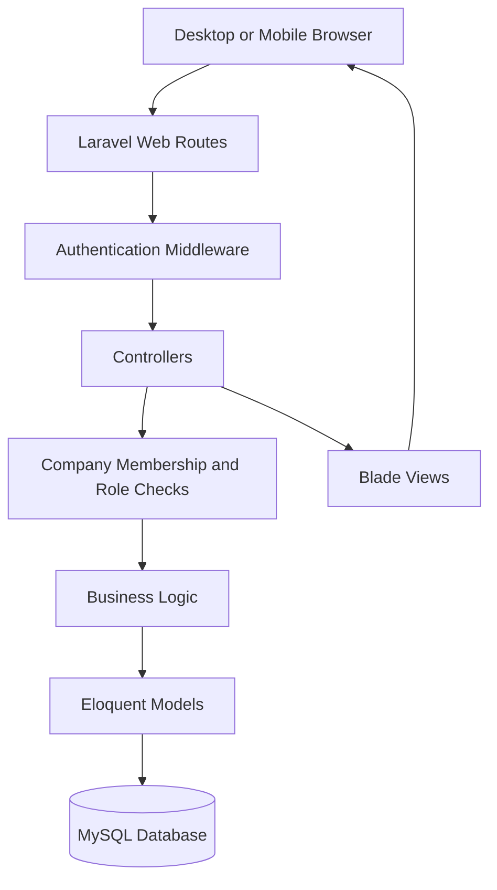
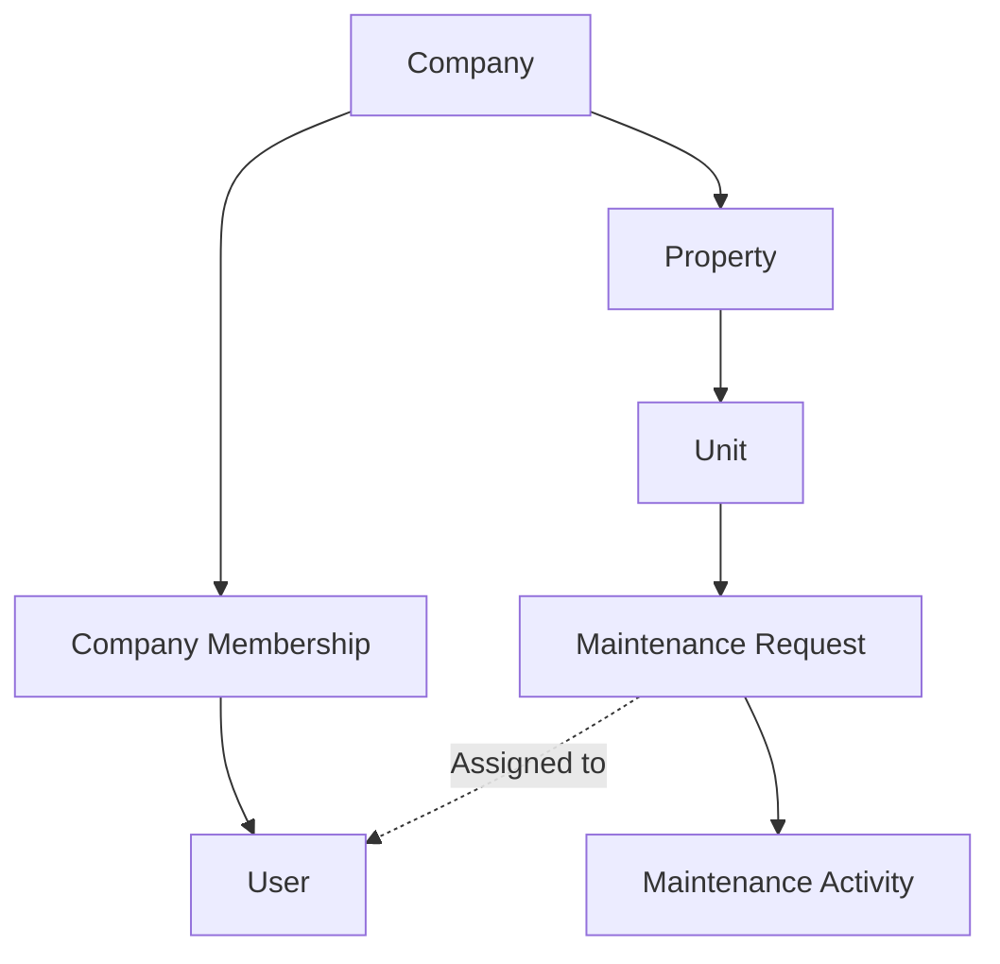
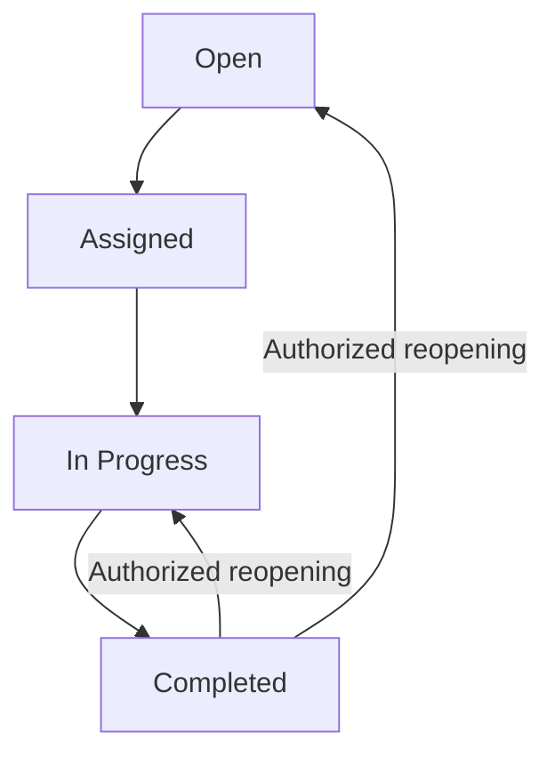
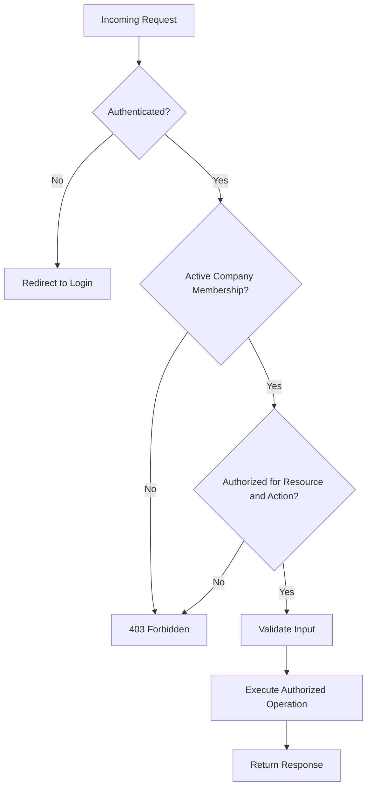

# FixFlow — System Design

FixFlow is a multi-company maintenance management application built with Laravel, MySQL, and Blade.

## 1. Application Architecture

The application uses server-rendered pages. Laravel handles request processing, validation, authorization, and database operations.

## 2. Multi-Company Data Model

Each maintenance request belongs to a unit, which belongs to a property, which belongs to a company.

Access to company data is controlled using active company memberships and role checks.

## 3. Work Order Lifecycle

This diagram illustrates common workflow transitions. The backend determines which transitions are permitted for each role.

## 4. Role-Based Access

| Capability | Administrator | Manager | Technician |
|---|---|---|---|
| View authorized work orders | Yes | Yes | Assigned jobs |
| Assign technicians | Yes | Restricted | No |
| Manage scheduling | Yes | Yes | No |
| View analytics | Yes | Yes | No |
| Complete assigned jobs | Through management workflow | Through management workflow | Yes |
| Change priority | Yes | Yes | No |

Permissions are enforced on the server, not only through the interface.

## 5. Security Architecture

## 6. Engineering Priorities

- Enforce company data isolation.
- Prevent unauthorized work order modifications.
- Maintain reliable activity history.
- Validate scheduling and completion workflows.
- Cover important behavior with automated feature tests.
- Keep the interface usable on desktop and mobile devices.

## 7. Planned Improvements

Future enhancements may include a public demo deployment, CI/CD pipeline, tenant portal, file attachments, notifications, and optimized analytics queries.

These features are planned and should not be confused with currently implemented functionality.
